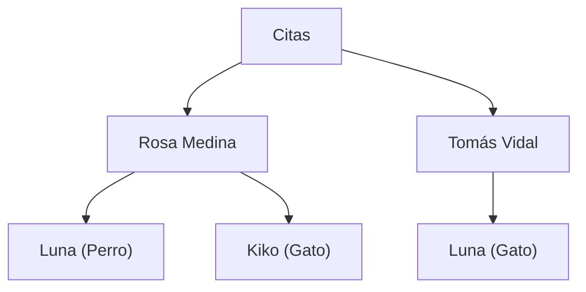
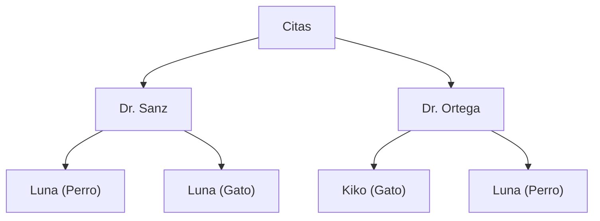

# UD01 - Práctica evaluable

##  Clínicas Veterinarias Bahía

| | |
|---|---|
| **Ciclo formativo** | 1º Desarrollo de Aplicaciones Web (DAW) |
| **Módulo profesional** | 0484 · Bases de Datos |
| **Unidad didáctica** | UD1 · Conceptos básicos · Modelos de bases de datos y arquitectura cliente-servidor |
| **Resultado de aprendizaje** | RA1. Reconoce los elementos de las bases de datos, analizando sus funciones y valorando la utilidad de los sistemas gestores. |
| **Criterios de evaluación** | RA1.a · RA1.b · RA1.c · RA1.d · RA1.e · RA1.f · RA1.g · RA1.h · RA1.i · RA1.j |
| **Modalidad** | Individual, en el aula |
| **Duración** | 1 hora y 30 minutos |
| **Calificación** | Sobre 10 puntos |

---

## 1. Instrucciones

1. Dispones de **120 minutos**. 
2. Puedes consultar las dos presentaciones de la unidad. **No se puede acceder a otros apuntes que no sean los disponibles en Moodle.**
3. **No se puntúan las definiciones copiadas.** Responde con tus propias palabras y **aplicando siempre la respuesta al caso** de Clínicas Veterinarias Bahía. Apóyate en datos concretos del enunciado (clientes, citas, incidencias).
4. Las respuestas deben ser **breves y precisas**: en la mayoría de los apartados bastan dos o tres líneas o completar la tabla propuesta.
5. Para la entrega de esta práctica, crea un repositorio en Github con el siguiente nombre: 1DAW-BBDD-XXX-UD01-P01, donde XXX son las siglas de tu nombre y apellido. Responde en este mismo documento, respetando la numeración, y entrégalo con el nombre `Apellido1_Apellido2_Nombre_RA1`.

---

## 2. Descripción del caso · 

**Clínicas Veterinarias Bahía** tiene dos clínicas, una en **Cádiz** y otra en **Puerto Real**, con unos 900 clientes y cuatro veterinarios. Cada clínica guarda su información en **ficheros** en el ordenador de recepción: Cádiz usa ficheros de texto y Puerto Real una hoja de cálculo con los campos en otro orden.

**Fichero `CLIENTES` · Clínica Cádiz**

| Nº_CLIENTE | DNI | NOMBRE | TELÉFONO | DIRECCIÓN | IBAN |
|---|---|---|---|---|---|
| CA-101 | 30111222A | Rosa Medina | 655100200 | C/ Brunete, 5 | ES21 **** 4321 |
| CA-102 | 30333444B | Tomás Vidal | 655300400 | Av. Cayetano del Toro, 20 | ES65 **** 8765 |

**Fichero `CLIENTES` · Clínica Puerto Real**

| Nº_CLIENTE | DNI | NOMBRE | TELÉFONO | DIRECCIÓN | IBAN |
|---|---|---|---|---|---|
| PR-045 | 30111222A | Rosa Medina | 699999888 | C/ Brunete, 5 | ES21 **** 4321 |

**Fichero `CITAS` · Clínica Cádiz**

| Nº_CLIENTE | NOMBRE_CLIENTE | MASCOTA | ESPECIE | FECHA Y HORA | VETERINARIO | MOTIVO | PRECIO |
|---|---|---|---|---|---|---|---|
| CA-101 | Rosa Medina | Luna | Perro | 03/11 10:00 | Dra. Sanz | Vacuna | 35 € |
| CA-101 | Rosa Medina | Kiko | Gato | 03/11 11:00 | Dr. Ortega | Revisión | 25 € |
| CA-102 | Tomás Vidal | Luna | Gato | 04/11 12:00 | Dra. Sanz | Vacuna | 30 € |
| CA-101 | Rosa Medina | Luna | Perro | 10/11 09:30 | Dr. Ortega | Revisión | 25 € |
| CA-150 | — | Rocky | Perro | 05/11 09:00 | Dr. Ortega | Revisión | 25 € |

### Incidencias del último mes

| Nº | Incidencia |
|---|---|
| **I1** | Rosa Medina comunicó un nuevo teléfono en Puerto Real. La clínica de Cádiz no pudo localizarla para darle un resultado urgente de Luna. |
| **I2** | El recepcionista (en persona) y una auxiliar (por teléfono) dieron **a la vez** la misma hora libre de la Dra. Sanz a dos clientes distintos. |
| **I3** | La gerente pidió un listado de las mascotas de ambas clínicas sin vacunar en el último año. El informático necesita **escribir un programa nuevo** y unificar antes los dos formatos. |
| **I4** | Un alumno en prácticas usa el ordenador de recepción y **puede ver el IBAN** de todos los clientes. |
| **I5** | Hay una cita del cliente **CA-150**, que no existe en `CLIENTES`. |
| **I6** | La misma vacuna figura con dos precios distintos (35 € y 30 €). |

### Plan de futuro

- **Sustituir los ficheros por un SGBD relacional.**
- **Abrir una tercera clínica en Chiclana** y conectar las tres.
- Lanzar una **aplicación web** para que los clientes pidan cita.
- **Analizar el historial** de citas para tomar decisiones de negocio.

En el proyecto participan **la gerente** (decide qué información necesita la empresa), **un técnico** contratado para administrar la base de datos, **una empresa** que programará la aplicación web, **el personal de recepción**, **los veterinarios** y **los clientes**.

---

## 3. Actividades

### Actividad 1. Análisis del sistema de ficheros · RA1.a · 1,8 puntos · 

**1.1.** (1,5 p) Completa la tabla. Indica qué problema de los sistemas de ficheros causa cada incidencia y **qué datos concretos** del enunciado lo demuestran.

| Incidencia | Problema de los sistemas de ficheros | Datos del enunciado que lo demuestran |
|---|---|---|
| I1 |Redundancia->Inconsistencia -> Datos duplicados |Rosa Medina está dada de alta por duplicado en ficheros indepedientes |
| I2 |Concurrencia -> Accesos simultáneos | Ya que al intentar a la vez la misma hora libre las dos consiguienron plaza cuando ya sobrepasa el aforo que es de una sola persona por hora libre|
| I3 | Aislamiento-> datos dispersos | Cada sede usa un formato distinto y los datos estan aislaldos en formatos incompatibles|
| I4 | Seguridad ->  Acceso no controlado|Ya que el alumno en prácticas puede ver el IBAN de los alumnos cuando ese dato no es importante  |
| I5 |Integridad -> Restrinciones dificiles de aplicar| En citas está registrado el cliente CA-150 pero este no existe en CLIENTES|
| I6 |Integridad -> Restricciones dificiles de aplicar | Como esta escrito manualmente los precios de las vacunas hay un fallo de que una misma vacuna tiene dos precios distintos|

**1.2.** (0,3 p) Observa el fichero `CITAS`. ¿Por qué el campo `MASCOTA` no puede usarse para identificar a cada animal? Propón un campo clave adecuado para un nuevo fichero `MASCOTAS` y justifica tu propuesta.
Porque se refiere al nombre del animal y varios animales pueden llamarse igual un campo clave adecuado podría ser cod-mascotas donde halla una clave única para cada animal y así reconocer sus datos de manera única.

---

### Actividad 2. Utilidad de un SGBD · RA1.d · 1.3 puntos

**2.1.** (0,5 p) Explica cómo evitaría un SGBD las incidencias **I2**, **I4** e **I5**, indicando en cada caso la **ventaja** del SGBD que lo permite.

**I2** : Compartición de datos donde miles de usuarios se pueden conectar y hacer cosas simultáneamente

**I4** : Mayor seguridad ya que con el DCL vamos a poder dar permisos de lo que cada uno puede ver y solo accederan a lo autorizado
**I5** :Mayor integridad ya que podrá ponerse restrinciones como que no puede haber un  cliente en citas si no está antes regitrado en clientes

**2.2.** (0,5 p) Indica **dos inconvenientes concretos** que tendría para Bahía implantar un SGBD y explica si, aun así, lo recomiendas.

Instalación Costosa

Intalación larga y compleja

Aún así si lo recomendaría porque resolvería mucho problemas ya hablados y le resultaria rentable a largo plazo .

**2.3.** (0,3 p) Una veterinaria rural trabaja sola, con unos 20 clientes, y apunta sus visitas en un fichero de texto. ¿Le recomendarías un SGBD? Justifícalo comparando su situación con la de Bahía.

No , porque para la cantidad de datos con las que trabaja , un SGBD sería demasiaddo trabajoso y costoso para lo que es.

---

### Actividad 3. Elementos de un SGBD · RA1.e · RA1.j · 1,4 puntos

**3.1.** (1 p) Para cada situación, indica **qué elemento del SGBD interviene** (núcleo, DDL, DML, DCL, utilidades o diccionario de datos) y **qué tipo de usuario la realiza** (administrador de datos, administrador de la base de datos, programador de aplicaciones, usuario final o ninguno si es automática).

| Nº | Situación | Elemento del SGBD | Tipo de usuario |
|---|---|---|---|
| 1 | La gerente decide que se registrará el número de microchip de cada mascota, lo que obliga a modificar la estructura de la tabla `MASCOTAS`. |DDL |Administrador de la base de datos |
| 2 | El técnico ejecuta `CREATE TABLE CITAS (...)`. |DDL | Administrador de la base de datos|
| 3 | El recepcionista consulta las citas de mañana de la Dra. Sanz. |DML |Usuario final |
| 4 | Se ejecuta `GRANT SELECT ON CITAS TO veterinarios;` | DCL| Administrador de la base de datos|
| 5 | El SGBD rechaza una cita porque el cliente no existe. |Núcleo  |automático |
| 6 | El técnico consulta qué tablas existen y qué permisos tiene cada usuario. | Diccionario de datos|Administrador de la base de datos|
| 7 | Se cargan en la base de datos los ficheros antiguos de las dos clínicas. |Utilidades  | Administrador de la base de datos|
| 8 | La empresa externa programa la pantalla de la web que registra una cita nueva. |DML  |Programador |

**3.2.** (0,4 p) Para cada cambio, indica el **nivel de la arquitectura** que se modifica (interno, conceptual o externo), el **tipo de independencia** que interviene (si procede) y **a quién afecta**.

| Cambio | Nivel | Independencia | ¿A quién afecta? |
|---|---|---|---|
| a) El técnico crea un índice sobre el DNI de los clientes para acelerar las búsquedas. |Interno (físico) |Independencia física |A nadie solo mejora la velocidad de las búsquedas |
| b) Se añade el campo `MICROCHIP` a la tabla `MASCOTAS`. |Conceptual (Lógico)|Indepedencia Lógica |Solo las nuevas funciones que requieran gestionar dicho `MICROCHIP` |
| c) Se crea una vista para el alumno en prácticas que no muestra el IBAN. | Externo (vistas)|Independencia lógica |A los alumnos en prácticas que ya no poodrán ver el IBAN  |

---

### Actividad 4. Modelos de datos · RA1.b · 2 puntos

Utiliza estos datos, extraídos del fichero `CITAS` (sin la cita errónea de CA-150):

- **Rosa Medina** tiene dos mascotas: **Luna** (perro) y **Kiko** (gato).
- **Tomás Vidal** tiene una mascota: **Luna** (gato).
- La **Dra. Sanz** ha atendido a Luna (de Rosa) y a Luna (de Tomás). El **Dr. Ortega** ha atendido a Kiko y a Luna (de Rosa).

**4.1.** (0,5 p) Representa en **modelo jerárquico** la relación *clientes → mascotas*. Explica por qué este modelo **sí** encaja bien en este caso.

**4.2.** (0,5 p) Ahora intenta representar en modelo jerárquico la relación *veterinarios → mascotas atendidas*. Indica qué dato queda **duplicado**, explica por qué ocurre y qué modelo de los vistos en la unidad lo evitaría.

Queda duplicado el dato de Luna (perro) , ocurre porque estamos ante una relación N:M por lo que el modelo ideal sería el relacional o jerárquico porque permiten el N:M pero mejor relacional porque es menos complejo

**4.3.** (1 p) Diseña en **modelo relacional** las tablas `CLIENTES`, `MASCOTAS`, `VETERINARIOS` y `CITAS`. Indica sus campos principales, la **clave primaria** (PK) y las **claves externas** (FK).
 
 `CLIENTES`(id_cliente PK, nombre y id_mascota FK)

 `MASCOTAS`(id_mascotas PK,especie, )

 `VETERINARIOS` (id_veterinario PK, nombre,id_mascota FK)

 `CITAS` (id_cliente, id_mascota, id_veterinario,motivo, precio)

---

### Actividad 5. Clasificación de los sistemas gestores · RA1.f · RA1.i · 1 punto

Completa la tabla. Si un sistema **no es un SGBD**, indícalo.

| Sistema | ¿Es un SGBD? | Modelo de datos | Ubicación (centralizada / distribuida) | Usuarios (uno / varios simultáneos) | Configuración |
|---|---|---|---|---|---|
| A. El sistema actual: ficheros en el ordenador de cada clínica. |No | No aplica| Distribuida|multiusuario | |
| B. La veterinaria rural instala SQLite en su portátil. | Si|Relacional | Centralizado|Monousuario | |
| C. MySQL en un servidor de Cádiz al que se conectan las dos clínicas. |Si | Relacional|Centralizado |multiusuario | |
| D. Cada una de las tres clínicas tiene su propio servidor PostgreSQL y el conjunto funciona como una única base de datos. |si |Relacional | distribuida|multiusuario | |

Explica en dos líneas por qué el sistema A **no es** una base de datos distribuida, aunque la información esté en dos ordenadores.

Porque es un sistema de ficheros tradicional es decir que no gestiona concurrencias, integridad ni catálogos

---

### Actividad 6. Ubicación de la información y bases de datos distribuidas · RA1.c · RA1.g · 2,5 puntos

Con la apertura de Chiclana, el técnico plantea dos opciones:

- **Opción A:** un único servidor en Cádiz al que se conectan las tres clínicas.
- **Opción B:** un servidor en cada clínica, que funcionan como una única base de datos distribuida.

**6.1.** (0,8 p · RA1.c) Para cada opción, indica **dónde se encuentra físicamente la información**, **una ventaja** y **un inconveniente** aplicados a Bahía.

| Opción | Ubicación de la información | Ventaja | Inconveniente |
|---|---|---|---|
| A |centralizada |administracion centralizada unida y los datos se actualizan a tiempo real |Si se cae en cadiz o falla falla en todos sitios  |
| B |Distribuida |total autonomia , nadie depende de nada |inviable tarifa multisede |

**6.2.** (0,5 p · RA1.c) La aplicación web seguirá una arquitectura de tres capas. Indica en qué capa (presentación, lógica o datos) se realiza cada tarea y justifica la tarea *b*:

- **a)** Mostrar el formulario para pedir cita.

Capa de presentacion 

- **b)** Comprobar que la hora elegida sigue libre.

Capa de datos

- **c)** Guardar la cita.

Capa logica

**6.3.** (1,2 p · RA1.g · RA1.h) Se corta la conexión a internet de la clínica de Puerto Real durante una mañana. ¿Qué ocurre en Puerto Real y en las otras clínicas con la opción A? ¿Y con la opción B?

Con la opción A en puerto real y e demas se va la conexión y en la opción b solo se cae en puerto eral

---

## 4. Resumen de la puntuación

| Actividad | Criterio | Tiempo orientativo | Puntuación máxima |
|---|---|---|---|
| Lectura del caso | — | 5 min | — |
| 1. Análisis del sistema de ficheros | RA1.a | 12 min | 1,8 |
| 2. Utilidad de un SGBD | RA1.d | 8 min | 1,3 |
| 3. Elementos de un SGBD | RA1.e | 12 min | 1,4|
| 4. Modelos de datos | RA1.b | 15 min | 2 |
| 5. Clasificación de los sistemas gestores | RA1.f, RA1.i | 7 min | 1 |
| 6.1 y 6.2. Ubicación de la información | RA1.c | 6 min | 1.2 |
| 6.3 Bases de datos distribuidas | RA1.g, RA1.h | 6 min | 1.3 |
| **Total** | | **90 min** | **10,00** |

---

## 5. Rúbrica de corrección

Una respuesta que reproduce contenido de los materiales **sin aplicarlo al caso** se califica como *Insuficiente*.

### Actividad 1 · RA1.a (1,25 p)

| Nivel | Puntos | Descriptor |
|---|---|---|
| **Excelente** | 1,25 | Relaciona correctamente las seis incidencias con su problema y cita los datos que lo demuestran (CA-101/PR-045, CA-150, 35 €/30 €…). Detecta que hay dos mascotas llamadas Luna y propone una clave única justificada. |
| **Notable** | 0,94 | Acierta cinco incidencias con datos concretos. La clave propuesta es correcta, aunque la justificación es breve. |
| **Suficiente** | 0,63 | Acierta tres o cuatro incidencias, con explicaciones genéricas, o la clave propuesta no garantiza la unicidad. |
| **Insuficiente** | 0 – 0,31 | Acierta menos de tres incidencias o se limita a enumerar los problemas de los ficheros sin relacionarlos con el caso. |

### Actividad 2 · RA1.d (1 p)

| Nivel | Puntos | Descriptor |
|---|---|---|
| **Excelente** | 1,00 | Explica cómo el SGBD evita I2, I4 e I5 y nombra la ventaja correcta en cada caso. Aporta dos inconvenientes aplicados a Bahía con una recomendación razonada. Justifica que la veterinaria rural no necesita un SGBD por el escaso volumen y la ausencia de usuarios simultáneos. |
| **Notable** | 0,75 | Las tres partes son correctas, aunque alguna justificación es genérica. |
| **Suficiente** | 0,50 | Resuelve correctamente dos de los tres apartados o los resuelve con poca relación con el caso. |
| **Insuficiente** | 0 – 0,25 | Copia ventajas y desventajas sin aplicarlas o afirma que un SGBD siempre es la mejor opción. |

### Actividad 3 · RA1.e · RA1.j (1,5 p)

| Nivel | Puntos | Descriptor |
|---|---|---|
| **Excelente** | 1,50 | Acierta el elemento y el usuario en al menos 7 de las 8 situaciones y clasifica correctamente los tres cambios de la 3.2 (nivel, independencia y afectados). |
| **Notable** | 1,13 | Acierta 6 situaciones y al menos dos cambios de la 3.2. |
| **Suficiente** | 0,75 | Acierta 4 o 5 situaciones y al menos un cambio de la 3.2, o confunde de forma puntual DDL/DML/DCL o DA/DBA. |
| **Insuficiente** | 0 – 0,38 | Acierta menos de 4 situaciones o confunde de forma sistemática los niveles de la arquitectura. |

### Actividad 4 · RA1.b (1,5 p)

| Nivel | Puntos | Descriptor |
|---|---|---|
| **Excelente** | 1,50 | El árbol clientes → mascotas es correcto y se relaciona con la relación 1:N. Identifica la duplicación de Luna (de Rosa) bajo dos veterinarios, la explica (un hijo, un solo padre) y propone el modelo en red. El diseño relacional incluye `CITAS` como tabla que relaciona mascotas y veterinarios, con PK y FK correctas, los datos completos y un código propio que distingue a las dos Lunas. |
| **Notable** | 1,13 | Los tres apartados son correctos, con algún error menor (una FK sin indicar, un dato omitido). |
| **Suficiente** | 0,75 | Resuelve correctamente dos apartados, o el diseño relacional tiene carencias importantes (no distingue a las dos Lunas o faltan claves externas). |
| **Insuficiente** | 0 – 0,38 | Las representaciones no corresponden a los modelos pedidos o el diseño relacional no permite reconstruir las citas. |

### Actividad 5 · RA1.f · RA1.i (0,75 p)

| Nivel | Puntos | Descriptor |
|---|---|---|
| **Excelente** | 0,75 | Clasifica correctamente los cuatro sistemas, identifica que A no es un SGBD y explica que no es una base de datos distribuida porque los ficheros están aislados, sin integración. |
| **Notable** | 0,56 | Clasifica correctamente tres sistemas y la explicación sobre A es correcta. |
| **Suficiente** | 0,38 | Clasifica correctamente dos o tres sistemas, pero la explicación sobre A es incorrecta o falta. |
| **Insuficiente** | 0 – 0,19 | Clasifica correctamente menos de dos sistemas o considera que los ficheros actuales son una base de datos distribuida. |

### Actividad 6 (6.1 y 6.2) · RA1.c (0,75 p)

| Nivel | Puntos | Descriptor |
|---|---|---|
| **Excelente** | 0,75 | Indica correctamente la ubicación de la información en ambas opciones, con ventajas e inconvenientes aplicados a Bahía. Asigna bien las tres tareas a su capa y justifica que la comprobación de la hora libre se hace en el servidor. |
| **Notable** | 0,56 | Las dos partes son correctas, pero alguna ventaja o inconveniente es genérico o la justificación de la tarea *b* es breve. |
| **Suficiente** | 0,38 | Resuelve correctamente solo una de las dos partes. |
| **Insuficiente** | 0 – 0,19 | Confunde centralizada y distribuida o sitúa la comprobación de la hora libre en el cliente. |

### Actividad 6 (6.3) · RA1.g · RA1.h (0,75 p)

| Nivel | Puntos | Descriptor |
|---|---|---|
| **Excelente** | 0,75 | Explica que con A Puerto Real queda sin servicio porque no puede conectarse al servidor central, mientras que con B sigue trabajando con sus datos locales. |
| **Notable** | 0,56 | Ambos apartados son correctos, pero no lo explica correctamente. |
| **Suficiente** | 0,38 | Solo resuelve correctamente uno de los dos apartados. |
| **Insuficiente** | 0 – 0,19 | No distingue el comportamiento de ambas opciones o copia las ventajas de las bases de datos distribuidas sin aplicarlas. |

### Aspectos formales (deducción máxima: 0,5 puntos)

| Aspecto | Deducción |
|---|---|
| Faltas de ortografía (a partir de la tercera) | 0,05 p por falta, hasta 0,25 p |
| Respuestas desordenadas, sin numeración o tablas ilegibles | Hasta 0,25 p |

### Calificación por criterio de evaluación

La nota de cada criterio, sobre 10, se obtiene dividiendo los puntos obtenidos entre la puntuación máxima y multiplicando por 10. Las deducciones formales solo se aplican a la nota global.

